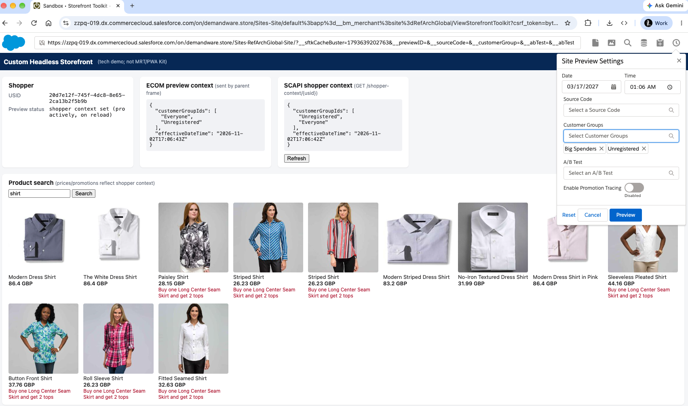
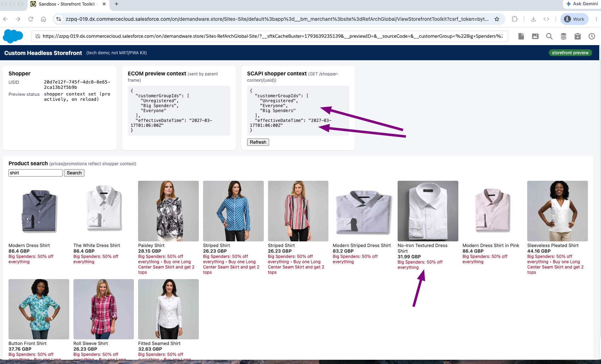
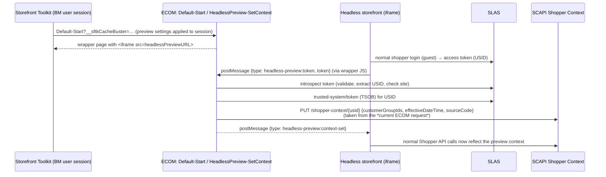

# B2C Commerce Headless Storefront Preview

Add Business Manager **Storefront Toolkit preview** support to a custom headless storefront. Merchants can preview customer groups, "shop the future" dates and times, and source codes on it.

Salesforce storefronts (**Storefront Next** and **PWA Kit**) running on Managed Runtime have their own preview integrations. This repository is for headless storefronts built and hosted any other way: your own framework and your own hosting.

It uses only standard platform features:

- **SCAPI Shopper Context** applies the preview settings to the shopper's API calls (prices, promotions, search, and so on)
- **SLAS Trusted System on Behalf (TSOB)** lets ECOM, and only ECOM, write that context for the shopper
- **A small ECOM cartridge** handles `Default-Start` (the URL the toolkit loads). It works as a **bare controller** with no SFRA required, and stays compatible with SFRA cartridge paths

This repository contains:

- `cartridges/app_headless_preview`: the ECOM cartridge
- `metadata/`: site preferences and service definition for the cartridge
- `demo-server/`: a dependency-free Node server and page that stand in for "your headless storefront"
- `demo-data/` (optional): a sample campaign and promotion for trying it out

<figure>
  
  <figcaption>

**Before preview.** The demo storefront is running inside the Storefront Toolkit. Both context panels show the shopper's default context: <code>Everyone</code> and <code>Unregistered</code>, with today's date. The product grid shows only the regular promotions. In the toolkit's **Site Preview Settings** (right), the merchant picks a future date and adds the **Big Spenders** customer group.

  </figcaption>
</figure>

<figure>
  
  <figcaption>

**After clicking Preview.** The toolkit reloads, and ECOM writes the new preview settings to the shopper's SCAPI Shopper Context. The **SCAPI shopper context** panel (arrows) now matches the ECOM preview context: <code>Big Spenders</code> is in the customer groups and <code>effectiveDateTime</code> is the future date. The storefront's ordinary Shopper Search calls now return the Big Spenders-only promotion ("Big Spenders: 50% off everything"), with no preview-specific code in the storefront's data fetching.

  </figcaption>
</figure>

## How it works



1. In the toolkit, `Default-Start` renders a wrapper page that iframes your storefront (site preference `headlessPreviewURL`). Outside the toolkit, it can optionally redirect to your storefront (`headlessPreviewRedirect`).
2. Your storefront detects that it's framed by Business Manager and sends its SLAS shopper access token to the wrapper with `postMessage`.
3. The wrapper posts the token to `HeadlessPreview-SetContext`. ECOM validates it (SLAS introspection), gets a TSOB token for that shopper, and writes the **current ECOM session's** context (customer groups, effective date/time, source code) to SCAPI Shopper Context.
4. The wrapper tells your storefront the context is set. Your storefront refetches its data, and from then on its Shopper API calls reflect the preview settings.

When the merchant changes preview settings, the toolkit reloads `Default-Start`. The cartridge remembers the shopper's USID in the session and updates the context *before* the iframe loads, so the storefront renders with the new settings straight away.

## What your storefront needs to do

The demo implements all of this in a few dozen lines; see `connectToPreviewParent()` in `demo-server/public/app.js`.

1. Use a normal SLAS shopper login. Keep tokens out of third-party cookies (for example in `sessionStorage` or memory), since your storefront runs in a cross-site iframe.
2. When framed (`window.parent !== window`), check the parent origin against an allowlist of your Business Manager hostnames.
3. Post `{type: 'headless-preview:token', token: <access token>}` to the parent, using that exact origin as `targetOrigin`. Retry until you get an answer, and resend on `headless-preview:parent-ready`.
4. On `{type: 'headless-preview:context-set', ok}`, refetch data. Ignore messages from any other origin.
5. Send a `Content-Security-Policy: frame-ancestors` header that allows only your Business Manager hostnames (see [Security considerations](#security-considerations)).

Your storefront's own SLAS client does **not** need any shopper context or TSOB scopes. The demo adds `sfcc.shopper-context` (read) only so it can display the current context.

## Setup

These are the high-level steps. [Setup with the b2c CLI](#setup-with-the-b2c-cli) below automates most of them.

1. **Create two private SLAS clients** for your site's channel:
   - **ECOM preview client**, used only by the cartridge's service. Scopes: `sfcc.ts_ext_on_behalf_of` and `sfcc.shopper-context.rw`. Don't use this client anywhere else.
   - **Storefront client**, for your headless storefront (or the demo server). Default shopper scopes; the demo also adds `sfcc.shopper-context`.
2. **Import the metadata** in `metadata/` (**Administration → Site Development → Site Import & Export**, or as part of your site archive):
   - `meta/system-objecttype-extensions.xml`: site preferences `headlessPreviewURL` and `headlessPreviewRedirect` (group **Headless Preview**)
   - `services.xml`: the `headless.preview.scapi` service, profile and credential
3. **Configure the service credential** (**Administration → Operations → Services → Credentials → `headless.preview.scapi`**):
   - URL: `https://{shortCode}.api.commercecloud.salesforce.com/shopper/auth/v1/organizations/{organizationId}/`
   - User / Password: the ECOM preview client ID and secret
4. **Upload the `app_headless_preview` cartridge** to your code version, and add it to the **front** of the site's cartridge path.
5. **Enable Shopper Context** for the site: **Merchant Tools → Site Preferences → Hybrid Auth Settings**.
6. **Set the preview URL**: **Merchant Tools → Site Preferences → Custom Preferences → Headless Preview → Headless Preview URL**, pointing to your storefront (for the demo, `http://localhost:3000/`). Optionally enable **Redirect Storefront** to send non-toolkit `Default-Start` requests to the same URL.
7. **Run the demo storefront** (optional):

   ```bash
   cp .env.example .env          # fill in short code, org ID, site ID and the storefront client
   cd demo-server && npm start   # http://localhost:3000
   ```

   `http://localhost:3000/` works as the preview URL when the browser running Business Manager is on the same machine, because browsers let an `https` page frame `http://localhost`. To share the demo with others, put it behind any public HTTPS URL and update the preview URL preference. For example, `npm run tunnel` starts a Cloudflare quick tunnel (requires `cloudflared`).

### Try it

1. In Business Manager, select the site and click **Storefront** to open the Storefront Toolkit.
2. The toolkit loads the wrapper, which iframes your storefront. In the demo, the badge reads "storefront preview", and both context panels show the same customer groups and date.
3. Open the toolkit **Preview** settings and change the date/time, customer groups or source code. The toolkit reloads, the shopper context updates, and SCAPI results reflect it.

### Demo promotion (optional)

`demo-data/` is a site archive for the `RefArchGlobal` site. It isn't needed for the integration itself. It contains a `headless-preview-big-spenders` campaign targeting the **Big Spenders** customer group, and a searchable 50%-off promotion, `headless-preview-big-spenders-50off`, covering the `storefront-catalog-m-non-en` catalog. After importing it, rebuild the product search index. Then select **Big Spenders** in the toolkit's Preview settings, and the demo's product grid shows the "Big Spenders: 50% off everything" callout (see the screenshots above).

## Setup with the b2c CLI

If you use the [b2c CLI](https://github.com/SalesforceCommerceCloud/b2c-developer-tooling), `scripts/setup.sh` does steps 2–4 and 6. You need Node 20+ and `jq`.

```bash
# 1. SLAS clients
b2c slas client create -i <instance> --channels <siteId> --name "headless-preview: ECOM preview (TSOB)" \
  --scopes sfcc.ts_ext_on_behalf_of,sfcc.shopper-context.rw --redirect-uri http://localhost:3000/callback --json
b2c slas client create -i <instance> --channels <siteId> --name "headless-preview: storefront" \
  --default-scopes --scopes sfcc.shopper-context --redirect-uri http://localhost:3000/callback --json

# 2. fill in .env (both clients, short code, org ID, site ID)
cp .env.example .env

# 3. import metadata + service credential, deploy the cartridge to the active code version,
#    put it first in the cartridge path, set the preview URL (defaults to http://localhost:3000/)
./scripts/setup.sh <instance> [preview-url]

# optional: also import demo-data/ and rebuild the search index
DEMO_DATA=1 ./scripts/setup.sh <instance> [preview-url]
```

`<instance>` is an instance name from your `dw.json` / b2c config. Set `B2C_CONFIG=/path/to/dw.json` to use a config outside the project. The script fills the service credential in at import time, so secrets are never written to the repository. You still need to enable Shopper Context in Hybrid Auth Settings (step 5).

## Security considerations

- **Restrict who can frame your storefront.** Send `Content-Security-Policy: frame-ancestors` with only your Business Manager hostnames, for example `frame-ancestors 'self' https://production-mycompany.demandware.net https://staging-mycompany.demandware.net`. Include any custom Business Manager hostnames you use. Use the same list as the allowlist your storefront checks before posting its token. The demo defaults to every sandbox and PIG domain (`*.dx.commercecloud.salesforce.com`, `*.demandware.net`) for convenience. Narrow it with `PREVIEW_PARENT_HOSTS` (exact hostnames or parent domains) for anything beyond a sandbox.
- **Only post the token to an exact, allowlisted origin.** Never use `'*'` as the `postMessage` target origin. Ignore incoming messages whose `origin` or `source` isn't the expected parent. The cartridge's wrapper does the same in the other direction: it only accepts messages from the configured preview URL's origin.
- **The context comes from ECOM, not the browser.** `HeadlessPreview-SetContext` takes only a shopper token, and it validates that token with SLAS (active, issued for this site's channel). Preview values come from the ECOM session, and only a Storefront Toolkit session (an authenticated Business Manager user) carries preview settings. Any other caller can only copy its own normal session context onto its own shopper.
- **Keep the TSOB client server-side and minimal.** The ECOM preview client has powerful scopes (`sfcc.ts_ext_on_behalf_of` lets it act on behalf of shoppers). Store its secret only in the service credential, give it only the two scopes above, and don't reuse it in the storefront. Rotate it like any other secret.
- **Don't log tokens.** The service has communication logging disabled, and its log filter masks tokens. Keep it that way in production.
- **Production instances:** shopper context changes affect real shopper sessions. Preview usually happens on staging or development instances, but if you enable this on production, scope the preview URL and `frame-ancestors` carefully.

## Coexisting with other cartridges

The cartridge only takes over `Default-Start` when `headlessPreviewURL` is set for the site. All names are distinct (`HeadlessPreview-*` controller, `headlessPreview*` preferences, `headless.preview.scapi` service), so it can sit **first** in a cartridge path that also contains SFRA or other storefront cartridges:

- **SFRA in the path** (`modules` cartridge): it extends the next `Default.js` with `server.extend(module.superModule)` and replaces only `Start`. When preview isn't active, the original `Start` chain runs.
- **No SFRA**: it exports `Start` directly. If the next `Default.js` loads without SFRA, the cartridge re-exports that file's other functions and uses its `Start` as the fallback when preview isn't active. Otherwise it returns `404 This site is headless.`

## Notes and limitations

- Preview runs as a **guest** shopper (TSOB `login_id=guest`). That covers most preview needs, since you can still preview registered-customer experiences by selecting the **Registered** (or any other) customer group in the toolkit. Previewing as a specific logged-in customer would need TSOB with that customer's login.
- On non-production instances, a shopper context lasts 1 day, with a quota of 5,000 contexts. TSOB is rate-limited to one call per shopper every 3 seconds (HTTP 409).
- Only the toolkit's **Preview** settings are supported. Other toolkit features (content, search and page designer tools) aren't.
- Shopper Context applies to SCAPI calls. Your storefront must refetch data after `context-set` (and must not serve cached responses to the preview shopper) to see the changes.
